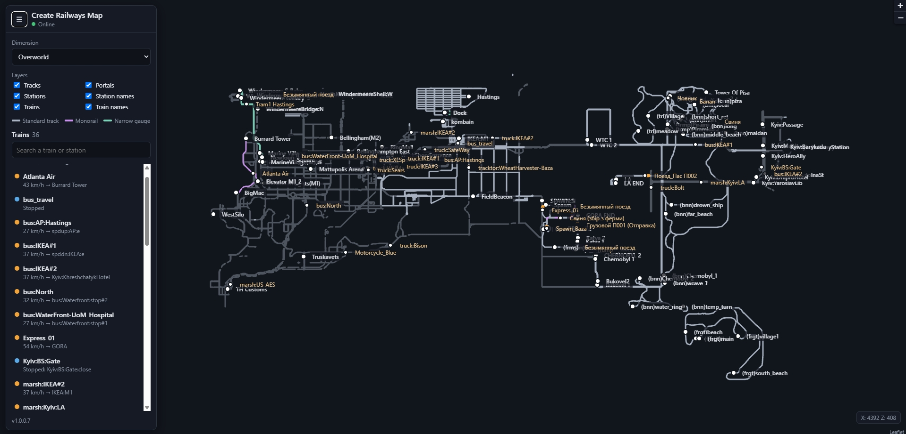
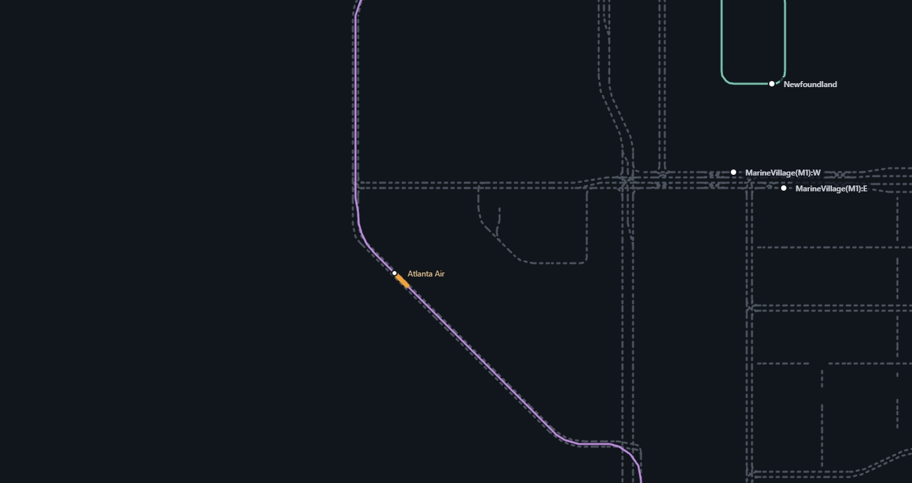
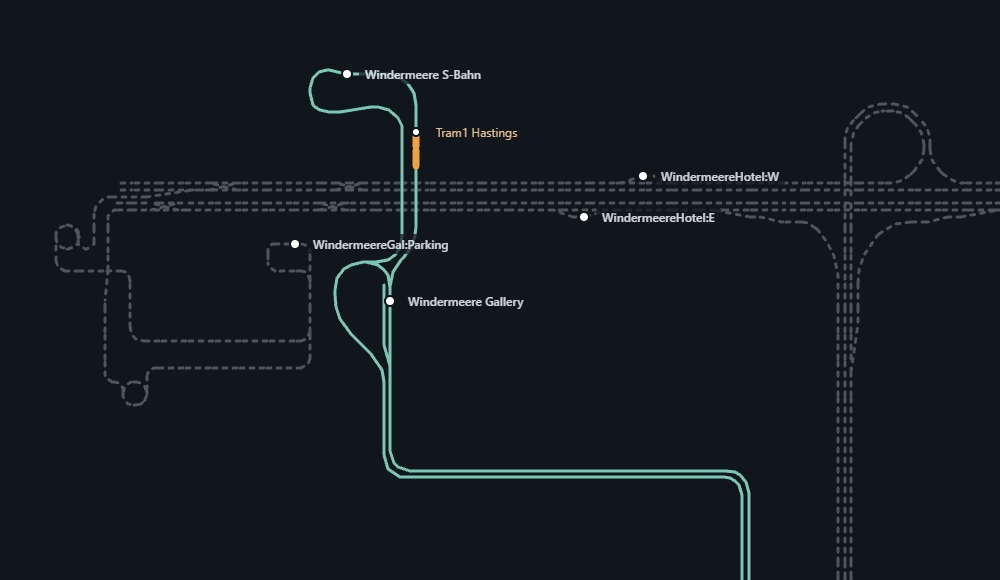

<div align="center">


# Create Railways Dynmap Bridge

**Live web map and Dynmap markers for Create & Steam 'n' Rails railways**

[](RELEASE_NOTES.md)
[](#requirements)
[](#requirements)
[](https://modrinth.com/mod/create)
[](#dynmap-markers)

[Features](#features) •
[Web map](#web-map) •
[Installation](#installation) •
[Configuration](#configuration) •
[Commands](#commands) •
[Troubleshooting](#troubleshooting) •
[Version history](#version-history)

</div>

---

<p align="center">
  
  <br/>
  <sub><i>The built-in live web map — every track, station and train of the server in one browser tab.</i></sub>
</p>

<a id="features"></a>

## ✨ Features

<table>
<tr>
<td width="50%" valign="top">

### 🗺️ Live web map
- Whole track network, **straight and curved**
- **Steam 'n' Rails** narrow gauge, wide gauge and monorail in their own colours
- Stations, portals between dimensions
- **Smoothly moving trains**, coloured by state
- Train list with **search** and **"follow this train"**
- English 🇬🇧 / Russian 🇷🇺 interface

</td>
<td width="50%" valign="top">

### 📍 Dynmap markers
- Create stations and trains on Dynmap
- Configurable marker icons
- Each layer can be switched off
- Automatic dimension → world mapping
- Separate station / train blacklists
- **Dynmap is optional** — the plugin works without it

</td>
</tr>
<tr>
<td width="50%" valign="top">

### ⚡ Built for live servers
- Main thread only copies numbers
- Track geometry rebuilt **only when the network changes**
- Website served from separate (virtual) threads
- Viewers receive **only what changed**

</td>
<td width="50%" valign="top">

### 🛠️ Admin tools
- `/railmap` — clickable link to the web map for everyone
- `/getstations`, `/gettrains` — lists in game or console
- `stations.txt` / `trains.txt` exports
- Old `config.yml` files are upgraded automatically

</td>
</tr>
</table>

<a id="web-map"></a>

## 🗺️ Live web map

Open `http://<server-ip>:25850/` in any browser (or type `/railmap` in game). No extra mods, no Dynmap needed.

<p align="center">
  
  
  <br/>
  <sub><i>Left: a train on a Steam 'n' Rails monorail. Right: a narrow gauge tram line. Dashed lines are phantom (invisible) tracks.</i></sub>
</p>

| On the map | Meaning |
| :--- | :--- |
| ⚪ Grey line | Standard Create track |
| 🟢 Green line | Narrow gauge (Steam 'n' Rails) |
| 🟡 Yellow line | Wide gauge (Steam 'n' Rails) |
| 🟣 Purple line | Monorail (Steam 'n' Rails) |
| ┅ Dashed line | Phantom track (invisible in game) |
| 🟠 / 🔵 / 🔴 Train | Moving / stopped / derailed |
| ⭕ Purple ring | Portal to another dimension — click to jump there |

**In the side panel:** switch dimensions, toggle layers and labels, search trains and stations, click a train to follow it. Click a station to see which trains are there and which are on their way. The page address keeps the current view, so a link can be shared.

> [!TIP]
> Visitors can switch the website language with `?lang=en` or `?lang=ru` at the end of the address, e.g. `http://example.com:25850/?lang=ru`.

<details>
<summary><b>⚡ How it stays light on the server</b></summary>

<br/>

| Step | Where it runs | How often |
| :--- | :--- | :--- |
| Copy train positions (2 points per carriage) | Main thread | Every 1 s (configurable) |
| Check whether tracks/stations changed | Main thread | Every 10 s |
| Rebuild track geometry | Main thread | Only on change (at least every 5 min) |
| Build JSON, serve the website | Separate threads | — |
| Send updates to browsers | Server-Sent Events | Only what changed |

All reflection lookups are cached, so even on hybrid servers such as Youer the per-update cost stays tiny. Between updates the browser animates trains on its own, so 1–2 second updates still look smooth.

</details>

<details>
<summary><b>🌐 Running behind nginx / a domain</b></summary>

<br/>

The map uses Server-Sent Events, which must not be buffered:

```nginx
location /trains/ {
    proxy_pass http://127.0.0.1:25850/;
    proxy_buffering off;
    proxy_read_timeout 1h;
}
```

Then set `web-map.public-url: "https://example.com/trains/"` so `/railmap` shows the right link.

</details>

<details>
<summary><b>🎨 Custom website files</b></summary>

<br/>

Files placed in `plugins/Create-Railways-Dynmap-Bridge/web/` replace the built-in ones with the same name — for example `index.html`, `assets/app.css` or `assets/app.js`. Delete them to go back to the built-in look.

</details>

<a id="requirements"></a>

## 📋 Requirements

| Component | Version / note |
| :--- | :--- |
| **Minecraft** | 1.21.1 |
| **Server** | Hybrid Bukkit + mods server (Youer, Mohist, Arclight, Magma…) |
| **Java** | 21 or newer, with the standard `jdk.httpserver` module (any normal JDK/JRE) |
| **Create** | 6.0.x — required |
| **Steam 'n' Rails** | Optional — extra track types are shown automatically |
| **Dynmap** | Optional — only needed for the Dynmap markers |

<a id="installation"></a>

## ⚙️ Installation

1. **Download** `Create-Railways-Dynmap-Bridge-1.0.0.7.jar` from the [Releases](../../releases) page.
2. **Install** — put the jar into the server's `plugins` folder. Remove older versions of the plugin first.
3. **Open the port** — allow TCP port **25850** in your firewall. On a hosting panel (Pterodactyl, etc.) add an extra port allocation and use that number as `web-map.port`.
4. **Start the server.** The plugin creates `plugins/Create-Railways-Dynmap-Bridge/` with `config.yml` and the blacklist files. The console should show:
   ```text
   [Create-Railways-Dynmap-Bridge] Create Railways - Dynmap Bridge 1.0.0.7 enabled; Dynmap stations: every 60s, Dynmap trains: every 5s.
   [Create-Railways-Dynmap-Bridge] Web map started on port 25850: http://<server-ip>:25850/ (trains every 1000 ms).
   ```
   Without Dynmap you will see `Dynmap is not installed — Dynmap markers are off` instead — that is fine.
5. **Open the map** — `http://<server-ip>:25850/` in a browser, or type `/railmap` in game.
6. **Adjust** `config.yml` (language, port, title, update intervals…) and restart the server.

> [!NOTE]
> Updating from an older version? The new settings are appended to your existing `config.yml` automatically, with comments. Nothing else in the file is changed.

<details>
<summary><b>🔨 Building from source</b></summary>

<br/>

```bash
./gradlew clean build        # Windows: .\gradlew.bat clean build
```

The jar appears in `build/libs/`. Any JDK 21 or newer works; the bytecode targets Java 21.

</details>

<a id="configuration"></a>

## 🔧 Configuration

All settings live in `plugins/Create-Railways-Dynmap-Bridge/config.yml`.

### 🌍 Language

```yaml
# "en" (English) or "ru" (Russian) — website and command messages
language: "en"
```

### 🗺️ Web map

```yaml
web-map:
  enabled: true
  bind-address: "0.0.0.0"
  port: 25850
  public-url: ""                         # link shown by /railmap
  title: ""                              # empty = default title in the selected language
  train-update-interval-seconds: 1       # trains are animated between updates
  network-check-interval-seconds: 10
  network-refresh-seconds: 300
  max-viewers: 50
  show-station-labels: true
  default-dimension: "minecraft:overworld"
  dynmap-url: ""                         # optional "Open Dynmap" link on the website
  dimensions: {}                         # custom / modded dimension names
```

<details>
<summary><b>All web map options explained</b></summary>

<br/>

| Option | Default | Description |
| :--- | :--- | :--- |
| `enabled` | `true` | Turns the web map on or off |
| `bind-address` | `0.0.0.0` | Network address to listen on (`0.0.0.0` = all) |
| `port` | `25850` | Website port |
| `public-url` | `""` | Link shown by `/railmap`; empty = built from the address the player joined with |
| `title` | `""` | Website title; empty = default title in the selected language |
| `train-update-interval-seconds` | `1` | How often train positions are sent (minimum 0.25) |
| `network-check-interval-seconds` | `10` | How often tracks and stations are checked for changes |
| `network-refresh-seconds` | `300` | Track geometry is rebuilt at least this often |
| `max-viewers` | `50` | Maximum simultaneous browser tabs |
| `show-station-labels` | `true` | Station names visible by default |
| `default-dimension` | `minecraft:overworld` | Dimension opened first |
| `dynmap-url` | `""` | Adds an "Open Dynmap" link to the website |
| `dimensions` | `{}` | Custom names, e.g. `"twilightforest:twilight_forest": "Twilight Forest"` |

</details>

<a id="dynmap-markers"></a>

### 📍 Dynmap markers

```yaml
dynmap-stations: true                  # stations on Dynmap
dynmap-trains: true                    # trains on Dynmap
station-icon: "bank"
train-icon: "bricks"
train-update-interval-seconds: 5
station-update-interval-seconds: 60
```

If Dynmap is not installed, the markers are switched off automatically and everything else keeps working.

### 🚫 Blacklists

| File | Hides |
| :--- | :--- |
| `blacklist-stations.yml` | Stations — on Dynmap **and** on the web map |
| `blacklist-trains.yml` | Trains — on Dynmap **and** on the web map |

```yaml
trains:
  - "Service train"
  - "bus:Depot"
```

Names are matched exactly (case-insensitive). Changes are picked up automatically, no restart needed.

### 🌐 World mapping

Create dimensions are matched to server worlds automatically and saved under `worlds:`. If a dimension lands on the wrong world, set it manually, e.g. `minecraft/overworld: survival`.

### 📁 File exports

`stations.txt` and `trains.txt` in the plugin folder list all station and train names. They are rewritten every `export-interval-seconds` (default 3600 = 1 hour).

### 📄 Full default `config.yml`

<details>
<summary><b>Show the complete file with comments</b></summary>

```yaml
# Create Railways - Dynmap Bridge 1.0.0.7
# Choose icon IDs from the list below. Changes take effect after restarting the server.

# ==== Language ====
# Language of the web map and of the plugin messages: "en" (English) or "ru" (Russian).
language: "en"

# Station icon
station-icon: "bank"

# Train icon
train-icon: "bricks"

# How often train markers are updated on Dynmap, in seconds (default: 5).
# Lower values = more up-to-date map, but more work for the server.
train-update-interval-seconds: 5

# How often station markers are updated on Dynmap, in seconds (default: 60).
# Stations rarely move, so this can stay high.
station-update-interval-seconds: 60

# Export interval in seconds for stations.txt and trains.txt (default: 3600 = 1 hour)
export-interval-seconds: 3600

# Available built-in Dynmap icons
# anchor, bank, basket, bed, beer, bighouse, blueflag, bomb, bookshelf, bricks,
# bronzemedal, bronzestar, building, cake, camera, cart, caution, chest, church,
# coins, comment, compass, construction, cross, cup, cutlery, default, diamond,
# dog, door, down, drink, exclamation, factory, fire, flower, gear, goldmedal,
# goldstar, greenflag, hammer, heart, house, key, king, left, lightbulb, lighthouse,
# lock, minecart, offlineuser, orangeflag, pin, pinkflag, pirateflag, pointdown,
# pointleft, pointright, pointup, portal, purpleflag, queen, redflag, right,
# ruby, scales, shield, sign, silvermedal, silverstar, skull, star, sun, temple,
# theater, tornado, tower, tree, truck, up, walk, warning, world, wrench

# ==== Dynmap markers ====
# Show Create stations on the Dynmap map (default: true).
dynmap-stations: true
# Show Create trains on the Dynmap map (default: true).
# If you use the live web map below, you can set this to false to save a bit of work.
dynmap-trains: true

# ==== Live web map ====
# A separate lightweight website with the track network, stations and moving trains
# (like Create Track Map / MTR). Open http://<server-ip>:<port>/ in a browser.
# The server only collects train positions; the website itself runs in separate threads.
web-map:
  # Turn the web map on/off (default: true).
  enabled: true
  # Network address and port of the web map. 0.0.0.0 = all addresses.
  # Remember to open this port in your firewall / hosting panel.
  bind-address: "0.0.0.0"
  port: 25850
  # Link shown by /railmap. Leave empty to build it automatically from the address
  # the player used to join (e.g. play.example.com) and the port above.
  # Example: "https://map.example.com/trains/"
  public-url: ""
  # Website title. Leave empty for the default title in the selected language.
  title: ""
  # How often train positions are sent to the website, in seconds (default: 1, minimum 0.25).
  # Trains move smoothly between updates, so 1-2 seconds looks fine.
  train-update-interval-seconds: 1
  # How often the server checks whether tracks or stations changed, in seconds (default: 10).
  network-check-interval-seconds: 10
  # Track geometry is rebuilt when the network changes, and in any case every N seconds (default: 300).
  network-refresh-seconds: 300
  # Maximum number of browser tabs watching the map at the same time (default: 50).
  max-viewers: 50
  # Show station names on the map by default.
  show-station-labels: true
  # Dimension opened first.
  default-dimension: "minecraft:overworld"
  # Optional link to your Dynmap shown on the website (empty = hidden). Example: "http://example.com:8123/"
  dynmap-url: ""
  # Custom names of dimensions on the website. Vanilla dimensions are already named
  # in the selected language; add modded dimensions or overrides here, for example:
  #   "minecraft:overworld": "Main world"
  #   "twilightforest:twilight_forest": "Twilight Forest"
  dimensions: {}

# ==== Worlds ====
# Mappings are added automatically when the bridge detects Create dimensions.
# Usually, this section does not need to be filled out manually.
# If auto-detection picks the wrong world, you can set an override manually.
# Example: minecraft/overworld: survival
worlds:
```

</details>

> [!IMPORTANT]
> Changes in `config.yml` take effect after a server restart. Blacklist files are re-read automatically.

<a id="commands"></a>

## 💻 Commands & Permissions

| Command | Permission | Default | Description |
| :--- | :--- | :---: | :--- |
| `/railmap` (`/trainmap`) | `create.railmap` | everyone | Shows a **clickable** link to the live web map (admins also see how many people are watching) |
| `/getstations` | `create.stations.admin` | op | Lists all Create stations from `stations.txt` (count + names) |
| `/gettrains` | `create.stations.admin` | op | Lists all Create trains from `trains.txt` (count + names) |

**How `/railmap` builds the link:**
1. `web-map.public-url`, if it is set;
2. otherwise the address the player used to join — e.g. a player who joined `play.example.com` gets `http://play.example.com:25850/`;
3. otherwise `server-ip` from `server.properties`.

In game the link is clickable: click it and the map opens in the browser. In the console it is printed as plain text.

> [!NOTE]
> `/getstations` and `/gettrains` read the exported files, which are refreshed every `export-interval-seconds` (1 hour by default).

<a id="troubleshooting"></a>

## 🩺 Troubleshooting

<details>
<summary><b>The web map does not open</b></summary>

<br/>

- Check the console for `Web map started on port …`. If you see `Web map could not start … Is the port already in use?`, choose another `web-map.port`.
- Make sure the port is open in the firewall / hosting panel and that you use the **server's public IP**, not `localhost` (unless the browser runs on the server itself).
- Check that `web-map.enabled` is `true`.

</details>

<details>
<summary><b>Tracks or stations are missing</b></summary>

<br/>

- Select the right dimension in the side panel.
- New tracks appear within `network-check-interval-seconds` (10 s by default).
- Check the blacklists — blacklisted stations and trains are hidden on the web map too.
- Look for console lines starting with `Web map:` — they name the part of Create that could not be read.

</details>

<details>
<summary><b>Trains do not move / update only on page reload</b></summary>

<br/>

- Behind nginx or another proxy, disable buffering for the map (`proxy_buffering off;`). Cloudflare and similar CDNs may also buffer Server-Sent Events — use a plain DNS record for the map.
- The status dot in the side panel shows the connection: green = online, red = reconnecting.

</details>

<details>
<summary><b>Dynmap markers do not appear</b></summary>

<br/>

- Dynmap must be installed as a server plugin. Without it the plugin logs `Dynmap is not installed — Dynmap markers are off`.
- Check `dynmap-stations` / `dynmap-trains` in `config.yml`.
- After `/dynmap reload` the markers are recreated automatically within one update.

</details>

<details>
<summary><b>The website language did not change</b></summary>

<br/>

Restart the server after changing `language`, then reload the page with <kbd>Ctrl</kbd> + <kbd>F5</kbd>. A single visitor can also use `?lang=en` / `?lang=ru`.

</details>

<a id="version-history"></a>

## 📦 Version History

### 🚀 Version 1.0.0.7
- **Live web map** built into the plugin: tracks with curves, Steam 'n' Rails gauges, portals, stations and smoothly moving trains; train list with search and "follow".
- **Dynmap is optional** — without it the web map and commands keep working.
- `dynmap-stations` / `dynmap-trains` switches (both on by default).
- **English / Russian** localization of the website and messages (`language`).
- `/railmap` command with the link to the map.
- Existing `config.yml` files get the new settings appended automatically.

<details>
<summary><b>Older versions</b></summary>

### Version 1.0.0.6
- **Fixed once-per-second server lag spikes:** the marker scan no longer repeats reflection lookups every second (each lookup is very slow on Youer). Lookups are cached, Bukkit calls are direct and blacklist files are checked once per update.
- **Separate update intervals** for trains (`train-update-interval-seconds`, 5 s) and stations (`station-update-interval-seconds`, 60 s).
- **Markers are only updated when something changed.**
- **Removed trains and stations now disappear from the map** (stale-marker cleanup never ran before).

### Version 1.0.0.5
- **NeoForge 1.21.1 (Build 265) Compatibility Fix:** Fixed the startup crash caused by an `IllegalArgumentException` / `argument type mismatch`. Completely removed brittle Java reflection for the task scheduler and replaced it with direct, safe `BukkitScheduler` calls, ensuring stable operation on NeoForge 21.1.265 and earlier versions.

### Version 1.0.0.4
- **Configurable File Export Interval:** Added `export-interval-seconds` (default: 3600s) to control how often `stations.txt` and `trains.txt` write to disk.
- **Performance Optimization:** Separated fast live Dynmap marker scans (1s) from background file export timers to reduce disk I/O.
- **Comment Preservation:** Switched to standard default configuration saving (`saveDefaultConfig()`) so all helpful comments and icon listings remain intact in `config.yml`.

### Version 1.0.0.3
- **Train Export & Command:** Added `trains.txt` auto-export and the `/gettrains` administrative command.
- **Station Export & Command:** Auto-exports `stations.txt` and adds the `/getstations` command.
- **Improved Reliability:** Enhanced world detection and background scan routines.

</details>

## 📄 License

**Copyright © 2026 Igrobar.** All rights reserved — see [LICENSE](LICENSE).

You may use the plugin for free on any server, including public and commercial ones. Re-uploading, selling or publishing modified versions requires the author's permission.

<sub>The web map uses [Leaflet](https://leafletjs.com) (BSD-2-Clause, see `web/assets/vendor/LEAFLET-LICENSE.txt`). The idea of a live map is inspired by [Create Track Map](https://github.com/jenchanws/create-track-map) (MIT); the web map code is written from scratch for this plugin.</sub>
