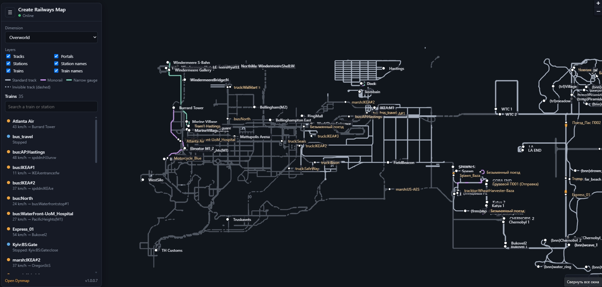
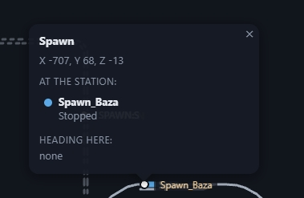
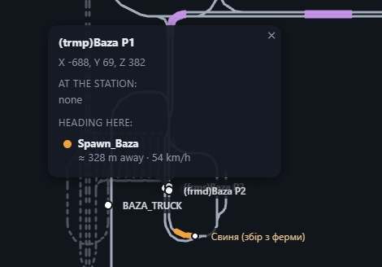

# 🚆 Create Railways Dynmap Bridge — v1.0.0.8

### Web map polish: clickable stations, per-dimension train list and more

   

  

This update improves the live web map introduced in 1.0.0.7. No configuration changes are needed.

## 🚉 Stations you can click

- 🐛 **Fixed:** clicking a station did nothing — the trains layer was catching all clicks. Stations now react to clicks and show a pointer cursor.
- 🧾 **New station window:**
  - **At the station** — trains standing there right now;
  - **Heading here** — trains whose schedule leads to this station, nearest first, with approximate distance, speed and a state dot;
  - updates live while it is open;
  - click a train in the window to **follow** it.
- 📐 The window is wider, long train names wrap instead of creating a sideways scrollbar, and the map moves so the window is never hidden under the side panel.

  
  &nbsp;
  

## 🗺️ Map and side panel

- 🚆 **Train list per dimension** — the list and the counter show only trains of the selected dimension, with a note like *"+35 in other dimensions"*.
- ┅ **Legend for invisible tracks** — a dashed *"Invisible track (dashed)"* entry explains phantom tracks: trains use them, but they are not visible in the game.
- 🌍 **Readable dimension names** — `minecraft:old` is shown as *Old*, `twilightforest:twilight_forest` as *Twilight Forest*. Custom names still come from `web-map.dimensions`.
- 🌀 **Fixed:** clicking a portal now jumps to its exit in the other dimension instead of the entrance coordinates.
- 🎨 **Dark scrollbars** in the train list and the station window, matching the page style.

## ⚡ Updates load right away

- 🔄 **Fixed:** after a plugin update browsers could keep showing the old website for up to an hour. The map files are now checked on every visit (a tiny "not modified" answer when nothing changed), so a new version appears immediately.

> [!NOTE]
> Updating from 1.0.0.7? Reload the map page once with <kbd>Ctrl</kbd> + <kbd>F5</kbd> — the old version may still be cached in your browser. After that, updates load automatically.

## ⚙️ Upgrade

1. Replace the old jar in `plugins` with `Create-Railways-Dynmap-Bridge-1.0.0.8.jar`.
2. Restart the server.
3. Open the map and press <kbd>Ctrl</kbd> + <kbd>F5</kbd> once.

## 📋 Requirements

- Java 21+ (standard JDK/JRE with the `jdk.httpserver` module)
- Minecraft 1.21.1 — Youer / Mohist / Arclight / other hybrid servers
- Create 6.0.x · Steam 'n' Rails optional · Dynmap optional
