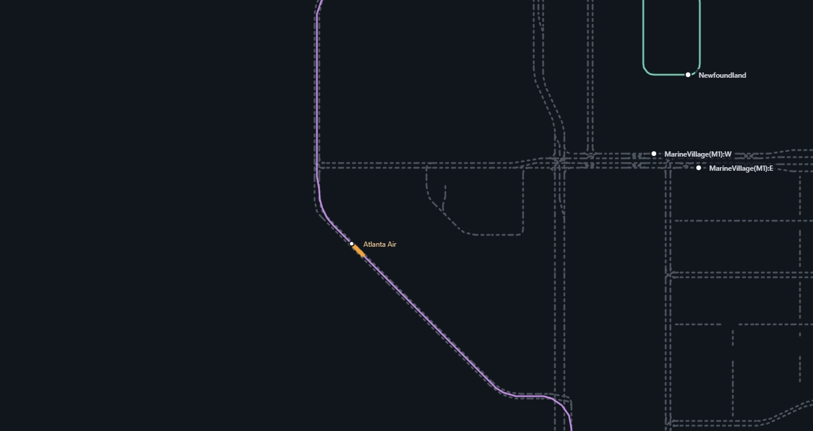

# 🚆 Create Railways Dynmap Bridge — v1.0.0.7

### The live web map update

  

## 🗺️ Live web map

The plugin now runs its own **live railway map** in the browser, like Create Track Map or MTR. Open `http://<server-ip>:25850/`, or type `/railmap` in game.

- 🛤️ **Every track** of the server, straight and curved
- 🎨 **Steam 'n' Rails** narrow gauge, wide gauge and monorail in their own colours; phantom tracks dashed
- 🚉 **Stations** — click one to see which trains are there and which are on their way
- 🚆 **Smoothly moving trains**, coloured by state: moving / stopped / derailed
- 🔎 **Train list with search**: speed, current station and destination
- 🎯 **Follow a train** — the map keeps it in view
- 🌀 **Portals** between dimensions — click to jump to the other side
- 🔗 **Shareable links** — the address keeps the current view

  
  

## ⚡ Light on the server

| Part | What it does |
| :--- | :--- |
| 🧵 Main thread | Only copies train positions — two points per carriage, once per second |
| 🛤️ Track geometry | Rebuilt **only when the network changes** |
| 🌐 Website | Served from separate (virtual) threads |
| 📡 Updates | Server-Sent Events — every viewer receives **only what changed** |

## 🧩 Also new

- 🔌 **Dynmap is now optional.** Without Dynmap the web map and commands keep working; with it, stations and trains still appear on Dynmap.
- 🎛️ **`dynmap-stations` / `dynmap-trains`** switches — both on by default.
- 🌍 **English / Russian** — `language: "en"` or `"ru"` switches the website and command messages. Visitors can also add `?lang=en` / `?lang=ru` to the address.
- 💬 **`/railmap`** (alias `/trainmap`) gives every player a **clickable link** to the map, built from the address they used to join the server.
- 🚫 **Blacklists** hide stations and trains on the web map too.
- 🔄 **Automatic config upgrade** — the new settings are appended to your existing `config.yml`, with comments.

## ⚙️ Upgrade

1. Replace the old jar in `plugins` with `Create-Railways-Dynmap-Bridge-1.0.0.7.jar`.
2. Open TCP port **25850** (or set `web-map.port` in `config.yml`).
3. Restart the server — the console shows `Web map started on port 25850`.

> [!NOTE]
> Behind nginx, add `proxy_buffering off;` for the map location, otherwise trains stop updating.

## 📋 Requirements

- Java 21+ (standard JDK/JRE with the `jdk.httpserver` module)
- Minecraft 1.21.1 — Youer / Mohist / Arclight / other hybrid servers
- Create 6.0.x · Steam 'n' Rails optional · Dynmap optional
